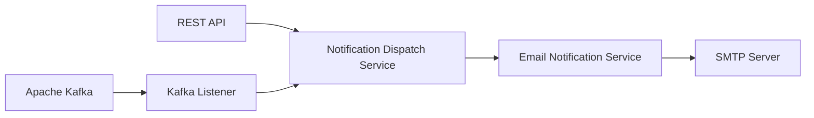

# User Notification Service

Notification microservice built with Java 21 and Spring Boot.

The service receives notification requests through REST API and Apache Kafka,
processes user-related events and sends email notifications.

The project demonstrates asynchronous service communication, separation of
responsibilities, validation, centralized exception handling and integration testing.

## Tech Stack

- Java 21
- Spring Boot 3
- Spring Web
- Spring Validation
- Spring Mail
- Apache Kafka
- Spring Kafka
- Spring Boot Actuator
- Maven
- JUnit 5
- Spring Boot Test
- Spring Kafka Test
- GreenMail

## Features

- REST API for sending notifications
- Asynchronous event processing through Apache Kafka
- Kafka listener and topic configuration
- Email notification delivery
- Request and event validation
- Centralized exception handling
- Custom application exceptions
- Separation of controller, business logic and infrastructure responsibilities
- Integration testing of notification scenarios

## Architecture

The service supports both synchronous HTTP requests and asynchronous Kafka events.



The application separates responsibilities between dedicated components:

- **NotificationController** — receives REST API requests
- **NotificationKafkaListener** — consumes user events from Apache Kafka
- **NotificationDispatchService** — coordinates notification processing
- **EmailNotificationService** — handles email notification delivery
- **NotificationMessageFactory** — creates notification messages
- **KafkaListenerConfiguration** — configures Kafka listener behavior
- **KafkaTopicConfiguration** — configures Kafka topics
- **GlobalExceptionHandler** — provides centralized API exception handling

Controllers do not contain business logic.

## REST API

The service provides an endpoint for sending notifications manually:

```http
POST /api/v1/notifications
Content-Type: application/json
```

Example request:

```json
{
  "operation": "USER_CREATED",
  "email": "user@example.com"
}
```

The request is validated and passed to the service layer for notification processing.

## Kafka Integration

Apache Kafka is used for asynchronous communication between services.

A user-related event can be published by another service and processed independently
by the notification service.

```text
Producer
   |
   v
Apache Kafka
   |
   v
NotificationKafkaListener
   |
   v
NotificationDispatchService
   |
   v
EmailNotificationService
   |
   v
SMTP Server
```

The event model is represented by `UserNotificationEvent`.

Example event:

```json
{
  "operation": "USER_CREATED",
  "email": "user@example.com"
}
```

Using Kafka allows notification delivery to be decoupled from the service that
produces the original business event.

## Error Handling

The project uses centralized exception handling through `GlobalExceptionHandler`.

Notification delivery failures are represented by a custom
`NotificationDeliveryException`.

This keeps exception handling outside the controller and provides a consistent
approach to application errors.

## Project Structure

```text
src/main/java/notificationservice
├── config
│   ├── KafkaListenerConfiguration
│   └── KafkaTopicConfiguration
│
├── controller
│   └── NotificationController
│
├── dto
│   ├── ApiErrorResponse
│   ├── NotificationOperation
│   ├── SendNotificationRequest
│   └── UserNotificationEvent
│
├── exception
│   ├── GlobalExceptionHandler
│   └── NotificationDeliveryException
│
├── kafka
│   └── NotificationKafkaListener
│
├── service
│   ├── EmailNotificationService
│   ├── NotificationDispatchService
│   ├── NotificationMessageConstants
│   └── NotificationMessageFactory
│
└── NotificationServiceApplication
```

## Testing

The project uses:

- JUnit 5
- Spring Boot Test
- Spring Kafka Test
- GreenMail

GreenMail is used for email integration testing without depending on an external
SMTP server.

Run the tests:

```bash
mvn clean test
```

## Running the Application

### Requirements

- JDK 21
- Maven
- Apache Kafka
- SMTP server

Clone the repository:

```bash
git clone https://github.com/Lersergeevna/user-notification-service.git
cd user-notification-service
```

Build the project:

```bash
mvn clean package
```

Run the application:

```bash
mvn spring-boot:run
```

Kafka and SMTP connection settings must be configured before startup.

## Engineering Practices

The project demonstrates:

- Object-Oriented Programming
- SOLID principles
- separation of concerns
- dependency injection
- thin controllers
- centralized exception handling
- custom application exceptions
- input validation
- asynchronous service communication
- event-driven interaction through Kafka
- integration testing
